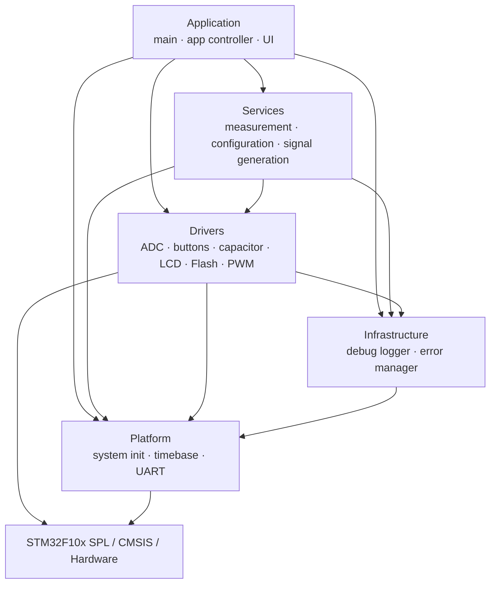

# Mini Multimeter Firmware Architecture

This document describes the architecture of the checked-in Mini Multimeter firmware for the **STM32F103C8T6**. The firmware is bare-metal: a cooperative super-loop coordinates application work while peripheral interrupts handle time-sensitive acquisition and timing events.

The design separates application state, measurement policy, hardware access, diagnostics, and MCU-facing platform code so each concern has a clear owner and lower-level modules never depend on higher-level behavior.

## 1. Architecture overview



Dependencies flow downward. A higher layer may skip intermediate layers when ownership requires it—for example, `ui_view` writes through the LCD driver and `app_controller` performs bootstrap through driver/platform interfaces—but lower layers must not include or call higher-level application or service code.

| Layer | May depend on | Must not depend on |
|---|---|---|
| Application | Services, Drivers, Infrastructure, Platform | — |
| Services | Drivers, Infrastructure, Platform | Application |
| Drivers | Infrastructure, Platform, STM32 SPL/CMSIS | Application, Services |
| Infrastructure | Platform | Application, Services, Drivers |
| Platform | STM32 SPL/CMSIS | Application, Services, Drivers, Infrastructure |

## 2. Components and ownership

| Area | Main modules | Responsibility |
|---|---|---|
| Application | `main`, `app_controller` | boot orchestration and top-level super-loop |
| Application UI | `ui_controller`, `ui_view`, `ui_formatter` | state/navigation, LCD presentation, value formatting |
| Services | `config_service` | runtime PWM settings and persistence requests |
| Services | `measurement_service` | resistance/capacitance/frequency/duty workflows and measurement states |
| Services | `signal_generator_service` | PWM validation and PSC/ARR/CCR calculation |
| Drivers | `adc_driver`, `button_driver` | ADC acquisition/filtering and debounced button events |
| Drivers | `capacitor_charge_driver` | capacitor charge/discharge GPIO control |
| Drivers | `flash_storage_driver` | versioned, CRC-protected persistent settings record |
| Drivers | `lcd1602_driver` | LCD1602/PCF8574 I2C transport and display I/O |
| Drivers | `pwm_capture_driver`, `pwm_output_driver` | timer input capture and TIM2 CH2 output |
| Infrastructure | `debug_logger`, `error_manager` | timestamped UART logs and centralized runtime error history |
| Platform | `platform_init`, `system_time`, `uart_port` | MCU startup wrapper, 1 ms timebase, USART1 transport |
| MDK | Keil project + CMSIS/RTE | toolchain, startup, device, and vendor configuration |

Repository layout:

```text
Application/        boot/application control and UI
Services/           measurement, configuration, signal-generation policy
Drivers/            peripheral-facing hardware access
Infrastructure/     diagnostics and error management
Platform/           shared MCU-facing services
MDK/                Keil project and CMSIS/RTE/vendor files
```

## 3. Runtime model

The firmware uses a cooperative super-loop rather than an RTOS. Initialization is centralized in `AppController_Init()`, followed by repeated non-blocking processing passes.

```text
Reset
  -> AppController_Init()
       -> Platform_InitSystem()
       -> ErrorManager_Init()
       -> ConfigService_Init() -> FlashStorage_Load()
       -> SystemTime_Init()
       -> ButtonDriver_Init()
       -> UartPort_Init() / DebugLogger
       -> MeasurementService_Init()
       -> SignalGeneratorService_Init()
       -> Lcd1602Driver_Init()
       -> UiController_Init()

while (1)
  -> AppController_RunOnce()
       -> ButtonDriver_Process()
       -> consume ButtonEvent_t
       -> UiController_HandleEvent()
       -> UiController_Update()
```

Time-critical peripheral work is interrupt-driven. State progression, UI decisions, persistence requests, and presentation remain in the main context, keeping interrupt handlers focused and avoiding RTOS/scheduler state.

## 4. UI architecture

UI decision, presentation, and formatting responsibilities are separate:

```text
ButtonEvent_t
  -> UiController
       -> decides state / navigation / action
       -> invokes Services for use cases
       -> UiView
            -> UiFormatter for text conversion
            -> Lcd1602Driver for display I/O
```

Key boundaries:

- `ui_controller.c` owns state and navigation, not LCD rendering details.
- `ui_view.c` owns display composition and LCD updates.
- `ui_formatter.c` has no hardware or service dependency.
- Measurement state comes from `MeasurementService_GetStatus()` rather than being inferred from a numeric result such as `0.0`.

The startup splash and save-confirmation screen are timed UI states using `SystemTime_GetTick()`. They do not block the super-loop with application-level delays. List-style menus also retain their own cursor positions so returning from a child screen restores the expected selection.

## 5. Measurement data flow

The UI selects a measurement mode; the Measurement Service owns the workflow and delegates hardware access to drivers.

```text
UiController
  -> MeasurementService_SetMode()
       -> Resistance
            -> AdcDriver
       -> Capacitance
            -> AdcDriver
            -> CapacitorChargeDriver
       -> Frequency / Duty
            -> PwmCaptureDriver
            -> PwmOutputDriver where the test/output path requires it

UiController
  <- MeasurementService_GetStatus()
  <- measurement result
```

The service exposes explicit states such as `MEASURING`, `CHARGING`, `NO_SIGNAL`, `NO_COMPONENT`, and `ERROR`, keeping presentation logic independent from raw peripheral values.

Sequential **All Mode** also preserves compatible hardware ownership across adjacent measurements:

- Resistance -> Capacitance keeps the ADC initialized and cancels only the previous conversion batch.
- Frequency -> Duty keeps PWM capture/output resources active where appropriate.

Detailed formulas, filtering, timing ranges, and component-detection behavior are documented in [docs/measurement.md](docs/measurement.md) and [docs/validation.md](docs/validation.md).

## 6. Signal-generation flow

PWM configuration separates policy/calculation from register-level application:

```text
UiController
  -> ConfigService
  -> SignalGeneratorService_Apply()
       -> validate requested frequency / duty
       -> calculate PSC / ARR / CCR
       -> PwmOutputDriver_ApplyTimer()
            -> TIM2 CH2 registers
```

Timer calculations belong to the Service layer; direct TIM2 register programming belongs to the Driver layer.

## 7. Persistence and diagnostics

### Persistent configuration

```text
UiController
  -> ConfigService_Save()
       -> FlashStorage_Save()
            -> metadata + CRC
            -> program
            -> read-back verify

Reset
  -> ConfigService_Init()
       -> FlashStorage_Load()
```

The final 1 KB Flash page (`0x0800FC00..0x0800FFFF`) is reserved for configuration storage and excluded from application code placement.

### Diagnostics

```text
Application / Services / Drivers
  -> DebugLogger
       -> SystemTime
       -> UartPort -> USART1

Runtime faults
  -> ErrorManager
       -> in-RAM history / coalescing
       -> DebugLogger when reported or flushed
```

Diagnostics are cross-cutting support and do not define measurement policy. `NO_COMPONENT`, for example, is a normal measurement status rather than an Error Manager fault.

## 8. Architectural invariants

1. **Bare-metal runtime:** application sequencing is handled by the super-loop and explicit state machines; no RTOS is required.
2. **Short interrupt work:** interrupts handle peripheral/timing events while higher-level decisions stay in the main context.
3. **Policy vs. hardware:** Services own measurement/configuration policy; Drivers own peripheral access and register application.
4. **UI separation:** the controller chooses what happens, the view decides how it is rendered, and the formatter only converts values to text.
5. **Non-blocking application feedback:** splash and save-feedback timing do not stop the super-loop.
6. **Explicit measurement states:** no signal, no component, charging, measuring, and error conditions are represented directly.
7. **Reserved persistence boundary:** the final Flash page is treated as data storage, not program space.
8. **Downward-only dependencies:** Platform and hardware-facing modules remain independent of application/menu behavior.

## 9. Related documentation

- [README.md](README.md) — project overview and portfolio landing page.
- [docs/hardware.md](docs/hardware.md) — pin mapping, peripherals, and clock assumptions.
- [docs/measurement.md](docs/measurement.md) — measurement and signal-generation algorithms.
- [docs/runtime.md](docs/runtime.md) — runtime behavior, UI details, persistence, diagnostics, and design trade-offs.
- [docs/validation.md](docs/validation.md) — recorded hardware validation and limitations.
- [docs/build-and-flash.md](docs/build-and-flash.md) — Keil build/flash workflow and footprint.
