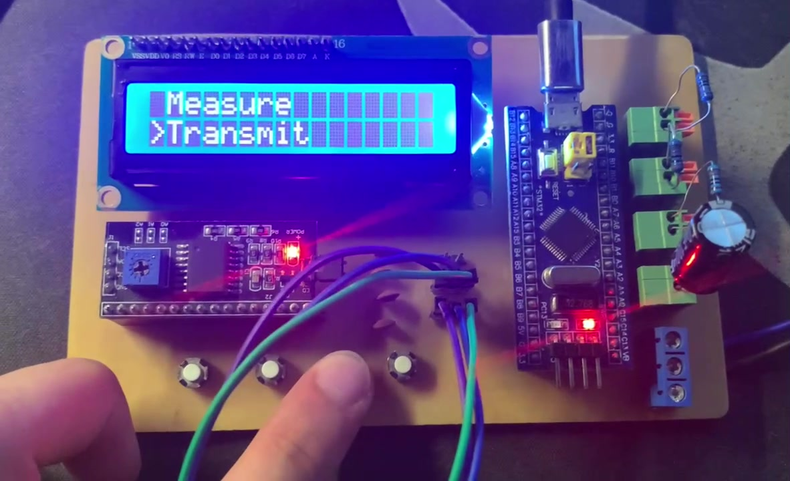
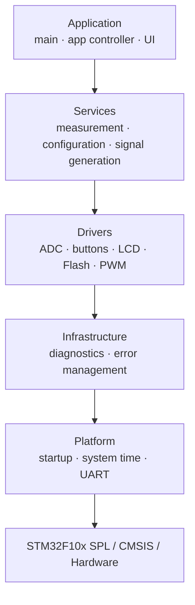

# Mini Multimeter


> Bare-metal STM32F103C8T6 firmware for resistance and capacitance measurement, PWM frequency/duty capture, and programmable PWM generation, with an LCD1602 interface, Flash-backed settings, UART diagnostics, and a layered architecture.

<p align="center">
  
</p>

<p align="center">
  <a href="Demo/demo.mp4">Demo video</a> ·
  <a href="ARCHITECTURE.md">Architecture</a> ·
  <a href="docs/README.md">Technical documentation</a> ·
  <a href="LICENSE">MIT License</a>
</p>

---

## Overview

Mini Multimeter is an embedded firmware project built around the **STM32F103C8T6**. It combines measurement and signal-generation functions in a single bare-metal application while keeping hardware access, measurement policy, UI behavior, diagnostics, and platform code separated into explicit layers.

The project intentionally uses a **super-loop plus interrupts instead of an RTOS**. Time-critical interrupt handlers remain short, while state machines and non-blocking workflows coordinate measurement, UI, persistence, and diagnostics in the main context.

### What it does

| Capability | Implementation |
|---|---|
| Resistance | ADC voltage-divider measurement with multi-stage stabilization and explicit open-socket detection |
| Capacitance | RC charge/discharge timing with a dedicated non-blocking measurement state machine |
| PWM frequency | Timer input capture with selectable low/mid/high capture ranges |
| PWM duty cycle | Period/high-time capture with explicit no-signal handling |
| PWM output | TIM2 CH2, configurable from 1 Hz to 100 kHz and 1% to 100% duty |
| User interface | LCD1602 over I2C plus four active-low push buttons |
| Persistence | Versioned internal-Flash record protected by CRC-32 and read-back verification |
| Diagnostics | USART1 logging plus centralized in-RAM error history |

---

## Hardware

| Item | Project configuration |
|---|---|
| MCU | STM32F103C8T6 |
| CPU | Arm Cortex-M3 |
| System clock | 72 MHz |
| Firmware model | Bare-metal super-loop + interrupts |
| Peripheral library | STM32F1 Standard Peripheral Library |
| Display | LCD1602 with PCF8574/PCF8574A I2C backpack |
| Analog acquisition | ADC1, interrupt-driven 16-sample batches |
| PWM output | TIM2 CH2 on PA1 |
| PWM capture | TIM1 / TIM3 / TIM4 selected by expected frequency |
| Debug channel | USART1 |
| Programmer/debugger | ST-Link |

Detailed pin mapping and clock assumptions are documented in **[docs/hardware.md](docs/hardware.md)**.

---

## Architecture

The firmware follows a layered dependency model so application logic is not coupled directly to MCU register-level behavior.



The top-level runtime remains deliberately simple:

```text
Reset
  -> initialize platform, services, drivers, UI
  -> enter super-loop
       -> process button input
       -> dispatch UI events
       -> advance non-blocking state machines
       -> render only required LCD updates
```

For the full layer responsibilities and runtime flow, see **[ARCHITECTURE.md](ARCHITECTURE.md)**.

---

## Firmware Highlights

- **No RTOS**: deterministic super-loop with short interrupt handlers and explicit state machines.
- **Non-blocking UI workflows**: startup splash, save feedback, and capacitance measurement progress without delay-based application blocking.
- **Explicit measurement states**: `MEASURING`, `CHARGING`, `NO_SIGNAL`, `NO_COMPONENT`, and `ERROR` are represented directly instead of being inferred from numeric values.
- **Resource-aware mode transitions**: sequential measurement modes preserve shared ADC or timer ownership when appropriate.
- **Filtered resistance measurement**: ADC averaging, low-pass filtering, median filtering, adaptive EMA, deadband, and change confirmation are combined for stable display behavior.
- **Robust settings storage**: Flash data includes magic/version/size checks, range validation, CRC-32, and programming read-back verification.
- **Controlled LCD traffic**: shadowed LCD content avoids repeatedly rewriting unchanged cells.
- **Centralized diagnostics**: UART logging and an Error Manager keep runtime faults visible without spreading logging policy through the application.

Technical details are split into focused documents instead of being embedded in this landing page:

- **[Measurement algorithms](docs/measurement.md)**
- **[Runtime, UI, persistence, and diagnostics](docs/runtime.md)**
- **[Hardware and pin mapping](docs/hardware.md)**

---

## Validation Summary

The repository documents hardware validation results for the implemented measurement paths. These values are **project validation data, not a calibrated metrology specification**.

| Measurement | Documented validation coverage | Documented error |
|---|---:|---:|
| Frequency | 100 Hz to 100 kHz | < 1% |
| Duty cycle | 10% to 90% | < 1% |
| Resistance | 100 Ω to 1 MΩ | approximately 2% to 10%, depending on range |
| Capacitance | 100 nF to 1000 µF | approximately 8% to 15%, depending on value |

The complete component-by-component tables and project limitations are in **[docs/validation.md](docs/validation.md)**.

---

## Build and Flash

The checked-in project targets **Keil µVision / Arm Compiler 6**.

```text
MDK/mini-multimeter.uvprojx
```

Quick start:

1. Open `MDK/mini-multimeter.uvprojx` in Keil µVision.
2. Verify the target device is `STM32F103C8`.
3. Build or **Rebuild all target files**.
4. Connect an ST-Link programmer/debugger.
5. Program the target and reset the MCU.
6. Verify the startup splash, main menu, and optional UART boot log.

The documented checked-in build used Arm Compiler 6 and reported **0 errors, 0 warnings**, with approximately **30.5 KB ROM** usage. Build prerequisites, Flash reservation details, and the recorded footprint are in **[docs/build-and-flash.md](docs/build-and-flash.md)**.

---

## Repository Layout

```text
mini-multimeter/
├── Application/        # boot/application control and UI
├── Services/           # measurement, configuration, signal-generation policy
├── Drivers/            # ADC, buttons, LCD, Flash, PWM, capacitor control
├── Infrastructure/     # diagnostics and error management
├── Platform/           # system initialization, timebase, UART transport
├── MDK/                # Keil project and STM32 CMSIS/RTE files
├── Demo/               # hardware demonstration video
├── docs/               # focused technical documentation
├── ARCHITECTURE.md     # architecture reference
├── README.md            # project landing page
└── LICENSE
```

---

## Documentation

| Document | Contents |
|---|---|
| [Technical documentation index](docs/README.md) | Entry point for detailed project documentation |
| [Architecture](ARCHITECTURE.md) | Layer boundaries, responsibilities, and runtime flow |
| [Hardware](docs/hardware.md) | Hardware, pins, peripherals, and clock assumptions |
| [Measurement](docs/measurement.md) | Resistance, capacitance, PWM capture, and PWM generation algorithms |
| [Runtime](docs/runtime.md) | Concurrency, UI state machines, Flash persistence, diagnostics, and design trade-offs |
| [Validation](docs/validation.md) | Measurement results, limitations, and future improvements |
| [Build and Flash](docs/build-and-flash.md) | Keil toolchain, build, programming, footprint, and references |

---

## Demo

The repository includes a hardware demonstration at **[Demo/demo.mp4](Demo/demo.mp4)** showing the LCD interface and measurement workflows running on the STM32 board.

---

## License

This project is released under the **[MIT License](LICENSE)**.
