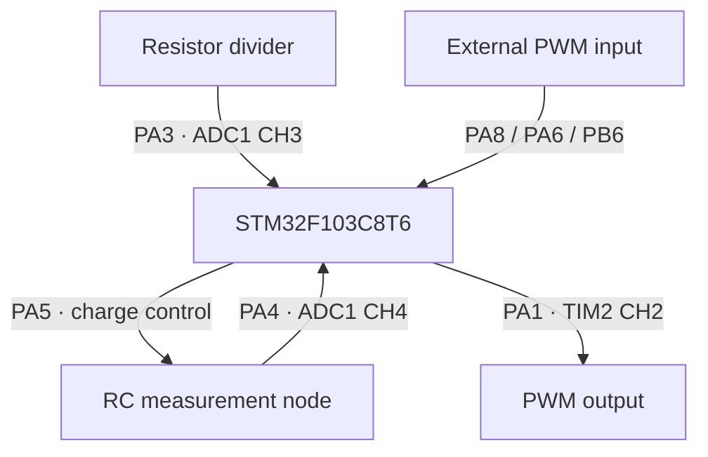
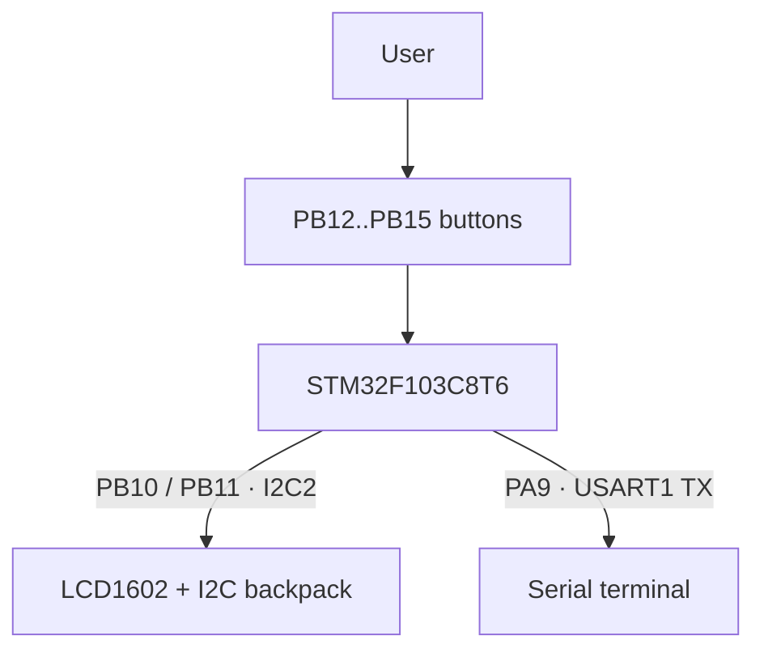

# Hardware and Pin Mapping

Hardware inventory, firmware pin assignments, functional signal paths, and clock assumptions for the STM32F103C8 implementation.

## Hardware and Pin Mapping

### Main hardware

- STM32F103C8T6 board.
- LCD1602 with PCF8574/PCF8574A I2C backpack.
- Four push buttons.
- Resistor voltage-divider network.
- Capacitor RC timing network.
- ST-Link programmer/debugger.
- Optional external PWM source or PA1 loopback for PWM measurement testing.
- UART-to-USB adapter if serial logs are required.

### Firmware pin map

| Function | Peripheral | Pin | Direction / mode | Purpose |
|---|---|---:|---|---|
| Resistance input | ADC1 CH3 | PA3 | Analog input | Voltage-divider ADC node |
| Capacitance input | ADC1 CH4 | PA4 | Analog input | RC voltage observation |
| Capacitor control | GPIOA | PA5 | Push-pull output while active | Charge/discharge control |
| PWM output | TIM2 CH2 | PA1 | Alternate-function push-pull | Generated PWM |
| PWM input, high range | TIM1 CH1/CH2 PWM-input mode | PA8 | Pull-down input | High-frequency capture |
| PWM input, mid range | TIM3 CH1/CH2 PWM-input mode | PA6 | Pull-down input | Mid-frequency capture |
| PWM input, low range | TIM4 CH1/CH2 PWM-input mode | PB6 | Pull-down input | Low-frequency capture |
| LCD SCL | I2C2 | PB10 | AF open-drain | 100 kHz I2C clock |
| LCD SDA | I2C2 | PB11 | AF open-drain | 100 kHz I2C data |
| UP button | GPIOB | PB12 | Input pull-up | Menu navigation |
| DOWN button | GPIOB | PB13 | Input pull-up | Menu navigation |
| SELECT button | GPIOB | PB14 | Input pull-up | Enter / confirm / return |
| CHARGE button | GPIOB | PB15 | Input pull-up | Start capacitor sequence |
| UART1 TX | USART1 | PA9 | AF push-pull | Debug logs |
| UART1 RX | USART1 | PA10 | Floating input | UART receive |

### Functional hardware view

The hardware is organized into two primary paths: measurement/signal processing and user interface/diagnostics.

**Measurement and signal path**



**User interface and diagnostics path**



### Clock assumptions used by the firmware

The Keil device startup configures the STM32F103 system for **72 MHz**. The project then derives peripheral timing from that clock tree:

```text
SYSCLK / HCLK       = 72 MHz
APB2                = 72 MHz
APB1                = 36 MHz
APB1 timer clock    = 72 MHz   (timer clock x2 when APB1 prescaler != 1)
ADC clock           = 12 MHz   (PCLK2 / 6)
I2C2                = 100 kHz  standard mode
SysTick             = 1 ms
```

These assumptions directly affect ADC timing, PWM generation, PWM capture, SysTick-based timeouts, and the capacitance calculation.

---
