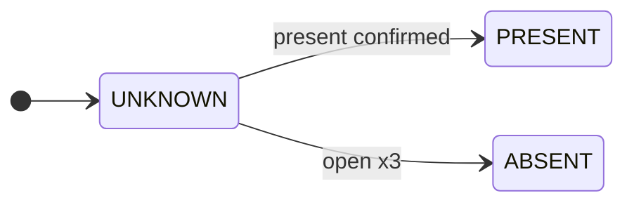
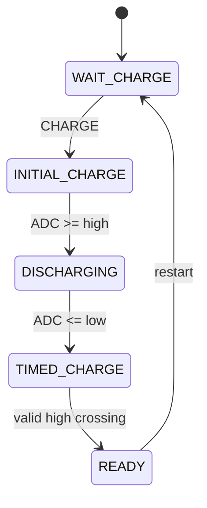
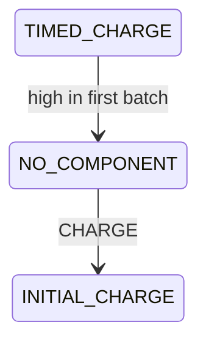
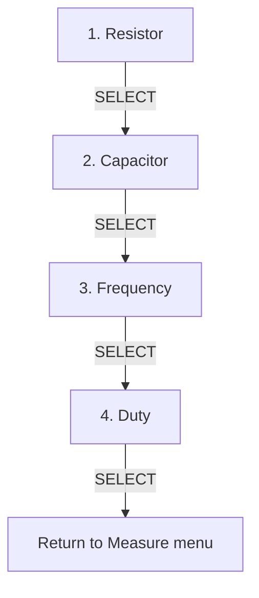

# Measurement and Signal Generation

Measurement principles, acquisition algorithms, range selection, and PWM signal-generation behavior implemented by the firmware.

## Measurement Principles and Algorithms

The measurement layer is not a single formula. Each mode combines a hardware principle with state validation, filtering, timeout handling, and UI publication rules.

### Resistance measurement

#### Circuit principle

```text
       3.3 V
         |
     Rref = 10 kΩ
         |
         +------> PA3 / ADC1_CH3
         |
        Rx
         |
        GND
```

For the divider:

```text
Vadc = Vcc * Rx / (Rref + Rx)
```

Therefore:

```text
Rx = Rref * Vadc / (Vcc - Vadc)
```

The firmware uses:

```text
Vcc             = 3.3 V
Rref            = 10 kΩ
ADC resolution  = 4096.0 counts in the normalization formula
```

So the implementation computes approximately:

```text
Vadc = filtered_adc / 4096.0 * 3.3
Rx   = 10000 * Vadc / (3.3 - Vadc)
```

#### ADC acquisition pipeline

The resistor path contains multiple filters, each solving a different problem:

```text
ADC1 CH3
   |
   v
16-sample integer average
   |
   v
ADC-driver LPF, alpha = 0.2
   |
   v
Median of last 5 ADC batches
   |
   v
Voltage-divider conversion
   |
   v
Adaptive EMA
   |
   v
Output deadband
   |
   v
300 ms sustained-change confirmation
   |
   v
1 s LCD sample-and-hold
```

The adaptive EMA uses two coefficients:

```text
relative change < 5%   -> alpha = 0.05
relative change >= 5%  -> alpha = 0.30
```

Small variations are strongly smoothed, while a real component change can converge faster.

The published resistance uses a deadband of:

```text
max(0.5% of current stable value, 1 Ω)
```

A value must remain outside that band in the same direction for **300 ms** before the stable value is replaced.

#### Resistor presence state

An open divider approaches ADC full scale. The service therefore uses asymmetric, stateful open/present qualification rather than a single threshold:

```text
open threshold      = 4075 counts
present threshold   = 4060 counts
open confirmation   = 3 batches
re-insertion count  = 5 batches
re-insertion time   = 200 ms continuous qualification
```

Resistor presence detection has two distinct phases: initial classification and steady-state hysteresis.

**Startup qualification**



**Steady-state presence hysteresis**


`ABSENT` maps to the UI status `No Resistor`. The hysteresis gap between 4060 and 4075 prevents status chatter near full scale.

---

### Capacitance measurement

#### RC network

```text
PA5 / CAP_CHARGE_CTRL
         |
   Rtiming = 20 kΩ
         |
         +------> PA4 / ADC1_CH4
         |
        Cx
         |
        GND
```

The firmware observes the capacitor node through ADC1 CH4 and controls charging through PA5.

For an ideal charging capacitor:

```text
V(t) = Vcc - (Vcc - Vstart) * exp(-t / RC)
```

The implementation does not measure a full `0 -> 63.2%` interval. It times the transition between two ADC thresholds:

```text
low threshold   = 1241 counts  ≈ 1.0 V
high threshold  = 2482 counts  ≈ 2.0 V
Rtiming         = 20 kΩ
```

The calibrated firmware equation is:

```text
C = 1.74563473 * t / 20000
```

where `t` is measured in seconds using the 1 ms SysTick timebase.

#### Capacitor state machine

The capacitor workflow has two outcomes during timed charging: a normal threshold-crossing measurement and an early no-component detection path.

**Normal measurement cycle**



**Early no-component detection**



Implementation sequence:

1. Enter capacitor mode.
2. Enable PA5 as a push-pull control output.
3. UI shows `Press Charge`.
4. CHARGE press starts initial charging.
5. Once the high threshold is crossed, PA5 is driven low and discharge begins.
6. Once the low threshold is crossed:
   - PA5 is driven high.
   - start tick is recorded.
   - the capacitor ADC filter is reset.
7. When the high threshold is crossed again, elapsed time is converted to capacitance.
8. PA5 is driven low and the result becomes `READY`.

If the timed-charge stage crosses the high threshold in its **first completed ADC batch**, the service reports `NO_COMPONENT`. For this project that represents an empty/open socket or a capacitance below the intended lower range.

---

### PWM frequency and duty measurement

The input driver uses STM32 timer **PWM Input mode**:

- CH1 captures the PWM period on rising edges.
- CH2 captures high time from the corresponding falling edge.
- The timer runs in reset slave mode triggered by TI1FP1.

```text
HIGH      +---------+              +---------+
          |         |              |         |
LOW  -----+         +--------------+         +------
          ^         ^              ^
          |<-Thigh->|              |
          |<---------- T --------->|
```

The service calculates:

```text
frequency = timer_clock_hz / period_ticks

duty (%)  = high_ticks / period_ticks * 100
```

A sample is accepted only when:

```text
period_ticks > 0
high_ticks <= period_ticks
```

If no fresh capture is observed for more than **1100 ms**, status becomes `NO_SIGNAL`.

#### Timer range selection

Only one capture timer is active at a time.

| Expected frequency | Timer | Pin | PSC | Effective counter clock |
|---:|---|---:|---:|---:|
| `< 200 Hz` | TIM4 | PB6 | 1098 | `72 MHz / 1099` |
| `200 Hz .. < 4 kHz` | TIM3 | PA6 | 7 | `9 MHz` |
| `>= 4 kHz` | TIM1 | PA8 | 0 | `72 MHz` |

Before enabling a range, the driver:

```text
Disable TIM1/TIM3/TIM4
-> mark no active channel
-> reset counters
-> clear pending CC/update flags
-> clear stale ready flags
-> prepare selected timer state
-> enable exactly one timer
```

The selected timer is based on the **expected frequency** supplied by the application, currently the configured signal-generator frequency. This is an explicit design trade-off: timer resolution is optimized for the expected frequency, while an unrelated external signal can be measured with a suboptimal timer configuration if the expected value does not match the input.

---

### Sequential `All Mode`

`All Mode` advances through four measurement screens using SELECT:



Resource transitions are intentionally optimized:

```text
Resistor -> Capacitor
    keep ADC enabled
    cancel only the old ADC batch

Frequency -> Duty
    keep the same MEASUREMENT_MODE_FREQUENCY_DUTY
    keep PWM capture/output resources active
```

This prevents unnecessary peripheral teardown/reinitialization during a sequential measurement workflow.

---


## PWM Signal Generation

PWM output is produced by **TIM2 Channel 2 on PA1**.

```text
Timer clock = 72 MHz
Frequency   = 1 Hz .. 100 kHz
Duty        = 1% .. 100%
```

### Timer equations

For TIM2:

```text
fPWM = 72 MHz / ((PSC + 1) * (ARR + 1))
```

PWM Mode 1 is used:

```text
CNT < CCR2   -> output HIGH
CNT >= CCR2  -> output LOW
```

The compare value is derived from duty:

```text
CCR2 ≈ (ARR + 1) * duty / 100
```

The driver clamps the compare value so it does not exceed ARR.

### Configuration search used by the service

`SignalGeneratorService` scans candidate prescalers from low to high.

For each PSC:

```text
ticks_candidate = round(timer_clock / ((PSC + 1) * target_frequency))
```

The candidate is accepted only if its tick count fits the 16-bit timer range.

Then:

```text
actual_frequency = timer_clock / ((PSC + 1) * ticks_candidate)
error            = abs(actual_frequency - target_frequency)
```

The implementation tracks the best candidate seen so far and stops when it reaches a configuration satisfying:

```text
error * 100 < target_frequency
```

which corresponds to an error below **1%** of the requested frequency.

The Service layer performs this calculation; `pwm_output_driver.c` only applies the final `PSC`, `ARR`, and `CCR2` values to TIM2.

---
