# Runtime, UI, Persistence, and Diagnostics

Runtime execution model, UI state machines, persistent configuration, diagnostics, and the principal design trade-offs of the firmware.

## Runtime and Concurrency Model

### Boot sequence

`main.c` is intentionally minimal:

```c
int main(void) {
  AppController_Init();
  while (1) {
    AppController_RunOnce();
  }
}
```

Initialization order is controlled by `AppController_Init()`:

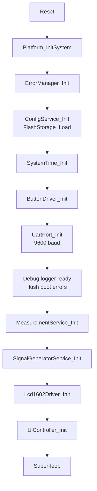

The Error Manager starts **before** Flash load and UART. This allows early Flash faults to be stored in RAM and emitted later when the logger becomes available.

### Main-loop work

Every `AppController_RunOnce()` iteration performs three high-level jobs:

```text
1. ButtonDriver_Process()
   -> sample GPIO
   -> debounce
   -> enqueue press events

2. Drain button-event FIFO
   -> UiController_HandleEvent(event)

3. UiController_Update()
   -> advance current UI/measurement state
   -> render only when state/value requires it

4. Observe UART TX timeout counter
   -> report new timeout to Error Manager
```

### Interrupt versus main context

The firmware uses interrupts only where asynchronous timing/data capture is useful.

Runtime concurrency is organized into two paths: system/UI event handling and measurement acquisition.

**UI and system-time path**

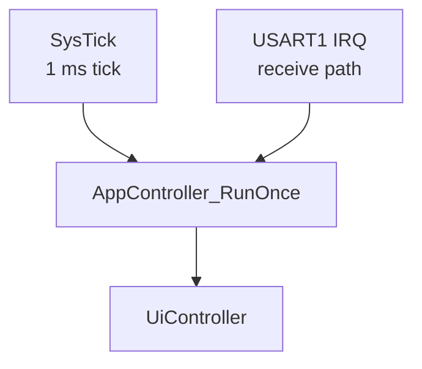

**Measurement path**

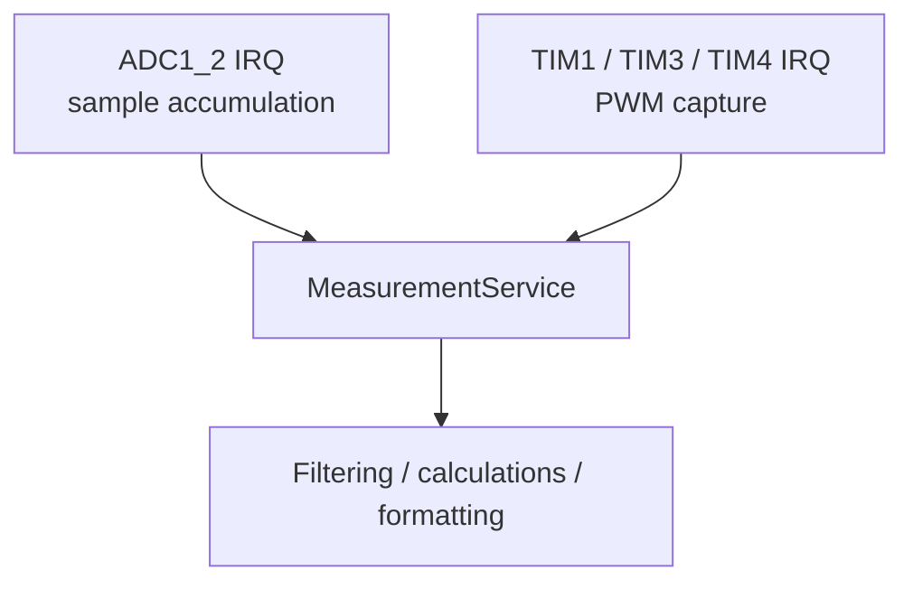

The ADC ISR intentionally avoids floating-point filtering and formatting. It only reads samples, accumulates an integer sum, and publishes a completed batch.

### ADC batch sequence

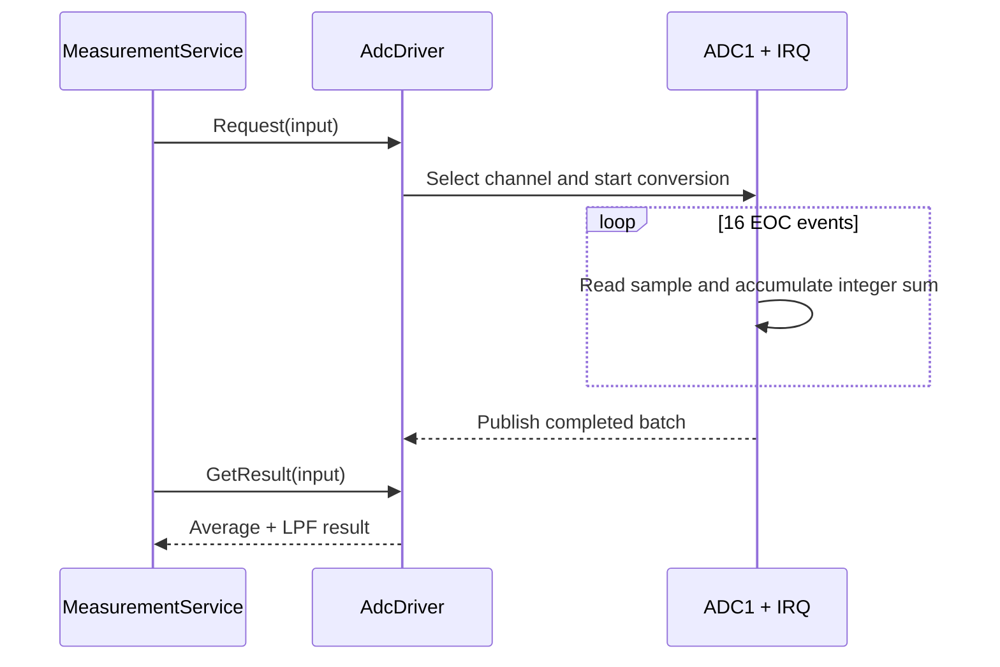

`MeasurementService` also runs a **100 ms ADC-result watchdog**. If an outstanding batch does not complete in time, the service cancels the ADC request, enters `ERROR`, and records `ADC_CONVERSION_TIMEOUT`.

### Interrupt priority intent

PWM capture is the most time-sensitive interrupt path in this project:

| Interrupt | Configured priority | Reason |
|---|---:|---|
| TIM1/TIM3/TIM4 capture | Preemption priority `0`, subpriority `1` | Preserve PWM edge timing |
| ADC1_2 | Preemption priority `1`, subpriority `0` | ADC batch timing is less critical than PWM capture |
| SysTick | CMSIS default after `SysTick_Config()` | 1 ms software timebase |
| USART1 RX | Enabled through NVIC | Debug/receive path; not part of measurement timing |

---


## User Interface and State Machines

### Buttons

| Button | Runtime meaning |
|---|---|
| UP | Navigate upward or increase an editable value |
| DOWN | Navigate downward or decrease an editable value |
| SELECT | Enter, confirm/save, advance `All Mode`, or leave measurement |
| CHARGE | Start capacitor measurement only while capacitor mode is active |

Buttons are active-low with internal pull-ups. A press is emitted only after the input remains at the new raw level for **20 ms**.

The event path is:

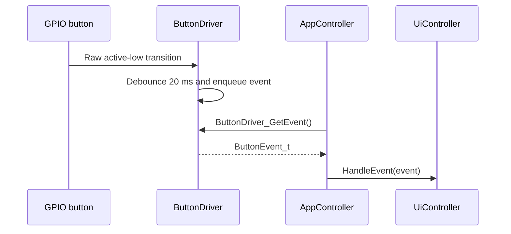

### Menu hierarchy

```text
MAIN
├── Measure
│   ├── Single Mode
│   │   ├── Resistor
│   │   ├── Capacitor
│   │   ├── Frequency
│   │   ├── Duty Cycle
│   │   └── Back
│   │
│   ├── All Mode
│   │   ├── Resistor
│   │   ├── Capacitor
│   │   ├── Frequency
│   │   └── Duty Cycle
│   │
│   └── Back
│
└── Transmit
    ├── Frequency
    ├── Duty Cycle
    ├── Setting
    │   ├── Frequency Step
    │   └── Duty Step
    └── Back
```

### UI state machine

The UI state machine is organized into top-level navigation, measurement navigation, measurement states, and transmit/settings states.

**Top-level navigation**

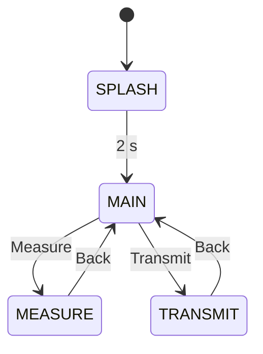

**Measure-mode navigation**

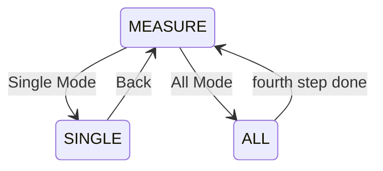

**Single-measurement branch**

```text
SINGLE
├── Resistor   -> RESISTOR
├── Capacitor  -> CAPACITOR
├── Frequency  -> FREQUENCY
└── Duty Cycle -> DUTY

SELECT in RESISTOR / CAPACITOR / FREQUENCY / DUTY
    -> Handle_Measure_Exit()
    -> SINGLE
```

This is the exact behavior implemented by `Handle_Measure_Single_Menu()` and `Handle_Measure_Exit()`.

**Transmit and settings branch**

Frequency, duty-cycle, and step-setting editors share the `SAVE_FEEDBACK` state. The return destination is selected through `saveFeedbackReturnMenu`.

**Frequency editor**

```text
TRANSMIT
  -> Frequency
  -> FREQ_EDIT
  -> SELECT / ConfigService_Save()
  -> SAVE_FEEDBACK (800 ms)
       ├── save OK   -> TRANSMIT
       └── save fail -> FREQ_EDIT
```

**Duty-cycle editor**

```text
TRANSMIT
  -> Duty Cycle
  -> DUTY_EDIT
  -> SELECT / ConfigService_Save()
  -> SAVE_FEEDBACK (800 ms)
       ├── save OK   -> TRANSMIT
       └── save fail -> DUTY_EDIT
```

**Step-setting sequence**

```text
TRANSMIT
  -> Setting
  -> FREQ_STEP
  -> SELECT / save
  -> SAVE_FEEDBACK (800 ms)
       ├── save OK   -> DUTY_STEP
       └── save fail -> FREQ_STEP

DUTY_STEP
  -> SELECT / save
  -> SAVE_FEEDBACK (800 ms)
       ├── save OK   -> TRANSMIT
       └── save fail -> DUTY_STEP
```

`SAVE_FEEDBACK` is one real UI state. `saveFeedbackReturnMenu` stores the state that should be entered after its 800 ms display interval, which is why the failure paths above return to the editor that initiated the save.

### Non-blocking transient states

Two visible delays are modeled as UI states instead of application-level blocking delays:

```text
Splash        = 2000 ms
Save feedback = 800 ms
```

During these states button events are ignored, but the super-loop continues running.

The LCD driver itself still uses short blocking delays where required by LCD initialization/clear timing. The important distinction is that normal application navigation does not call a delay to hold a screen on display.

### Per-menu cursor memory

Each list-style menu has its own cursor slot:

```text
Main
Measure
Single Mode
Transmit
```

Child states therefore do not overwrite the parent selection. `Back` is treated as a navigation command rather than a useful resume position; returning to the menu restores its last non-Back item.

### LCD rendering strategy

`ui_view.c` maintains a two-row shadow buffer of exactly 16 characters per row.

The view layer:

- Avoids rewriting a row when the new 16-character image is unchanged.
- Writes exactly 16 cells when a row changes so stale characters cannot remain.
- Can update individual cells for scroll indicators.
- Keeps display-specific logic out of `ui_controller.c`.

Measurement redraw policy is also mode-specific:

| Mode | Display policy |
|---|---|
| Resistance | 1 s READY qualification + 1 s sample-and-hold |
| Frequency | At least 300 ms between accepted redraws; relative/absolute change threshold |
| Duty | At least 300 ms between accepted redraws; 0.1% absolute change threshold |
| Capacitor | Redraw on status/result transitions |

---


## Configuration and Flash Persistence

Persistent settings are owned by `ConfigService`:

| Setting | Valid range | Default |
|---|---:|---:|
| PWM frequency | 1 .. 100000 Hz | 50000 Hz |
| PWM duty | 1 .. 100% | 50% |
| Frequency step | 1 .. 10000 Hz | 1000 Hz |
| Duty step | 1 .. 10% | 1% |

### Reserved Flash region

The Keil linker/scatter configuration limits the application load region to:

```text
Application IROM:
0x08000000 .. 0x0800FBFF
size = 0xFC00 bytes
```

The final 1 KB page is reserved for configuration:

```text
Configuration page:
0x0800FC00 .. 0x0800FFFF
```

This prevents normal application growth from overlapping the persistent record.

### V1 record layout

The private on-Flash record is 24 bytes:

```text
+----------------------+---------------------------+
| Field                | Purpose                   |
+----------------------+---------------------------+
| magic        u32     | 0xA5A5A5A5                |
| version      u16     | current format = 1        |
| record_size  u16     | sizeof(Config_t)          |
| frequency    u32     | PWM frequency             |
| duty         u16     | PWM duty                  |
| freq_step    u16     | frequency editor step     |
| duty_step    u8      | duty editor step          |
| reserved[3]          | deterministic padding     |
| crc32        u32     | IEEE CRC-32               |
+----------------------+---------------------------+
```

CRC uses polynomial `0xEDB88320` and covers all bytes before the `crc32` field.

### Load state

Configuration loading consists of a V1 validation path followed by a legacy/default recovery path when the current record is invalid.

**Current V1 record validation**

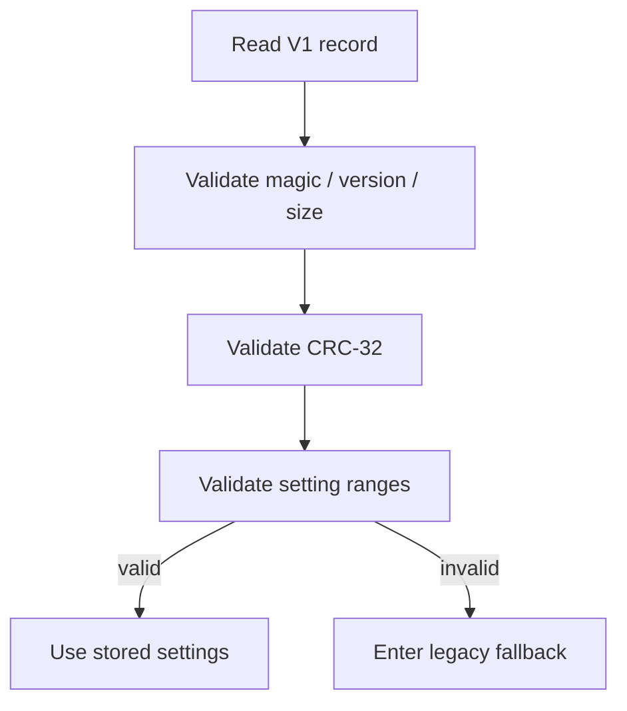

**Legacy fallback**

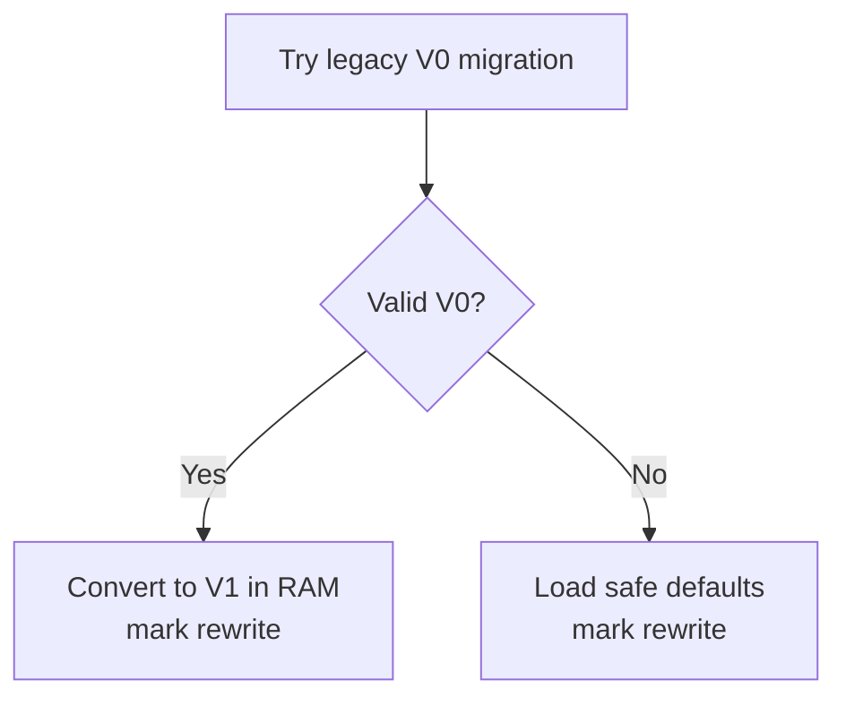

A migrated/default record is not immediately forced to Flash during boot; it is marked so the next save can rewrite the current format.

### Save transaction

The save operation has two stages: record preparation/change detection and the Flash erase-program-verify transaction.

**Prepare and decide whether a write is needed**

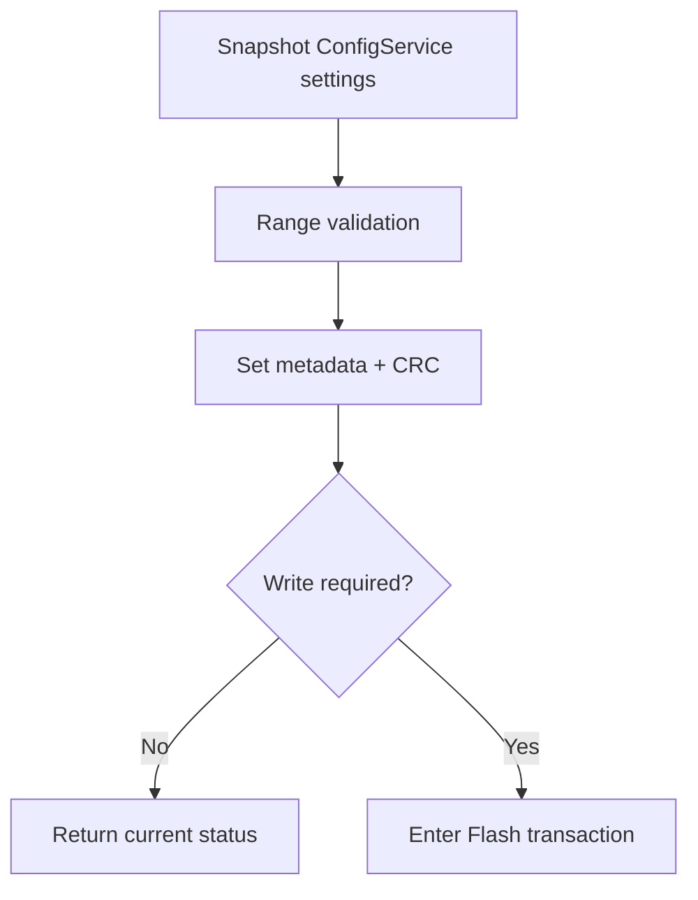

**Flash transaction and verification**

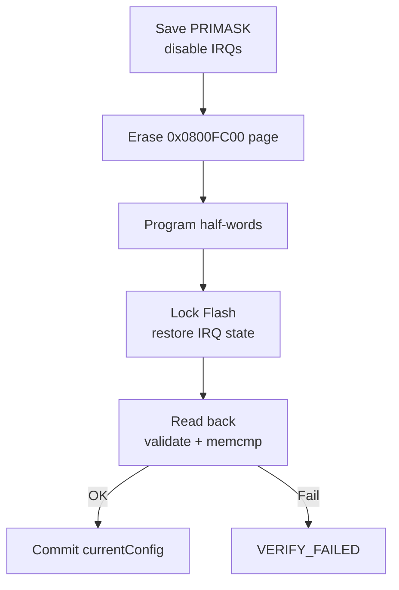

The driver reports separate statuses for:

```text
BAD_MAGIC
BAD_VERSION
BAD_SIZE
BAD_CRC
BAD_RANGE
ERASE_FAILED
PROGRAM_FAILED
VERIFY_FAILED
MIGRATED_V0
```

---


## Diagnostics and Error Handling

### UART debug channel

USART1 is configured as:

```text
TX      = PA9
RX      = PA10
Baud    = 9600
Format  = 8-N-1
```

The default compile-time log level is `INFO`:

```text
ERROR
WARN
INFO
TRACE
```

Log format:

```text
[timestamp_ms][level][module] message
```

Example:

```text
[0000000000][INFO][APP] Boot
[0000000000][WARN][FLASH] 0x0105 BAD_CRC
[0000000000][INFO][APP] Config F=50000Hz D=50% Fstep=1000 Dstep=1 (BAD_CRC)
[0000000001][INFO][LCD] Scanning I2C2 addresses
[0000000015][INFO][LCD] Found at 0x27
[0000000280][INFO][LCD] Init OK
```

### Error Manager model

The Error Manager keeps an 8-entry in-RAM history:

```text
Error_Record_t
├── source
├── code
├── severity
├── timestamp_ms
└── repeat_count
```

Identical adjacent errors occurring within **1000 ms** are coalesced instead of consuming a new history slot or flooding UART.

Error handling consists of two independent concerns: repeated-error coalescing and delivery of newly stored records to the logger.

**Error coalescing**

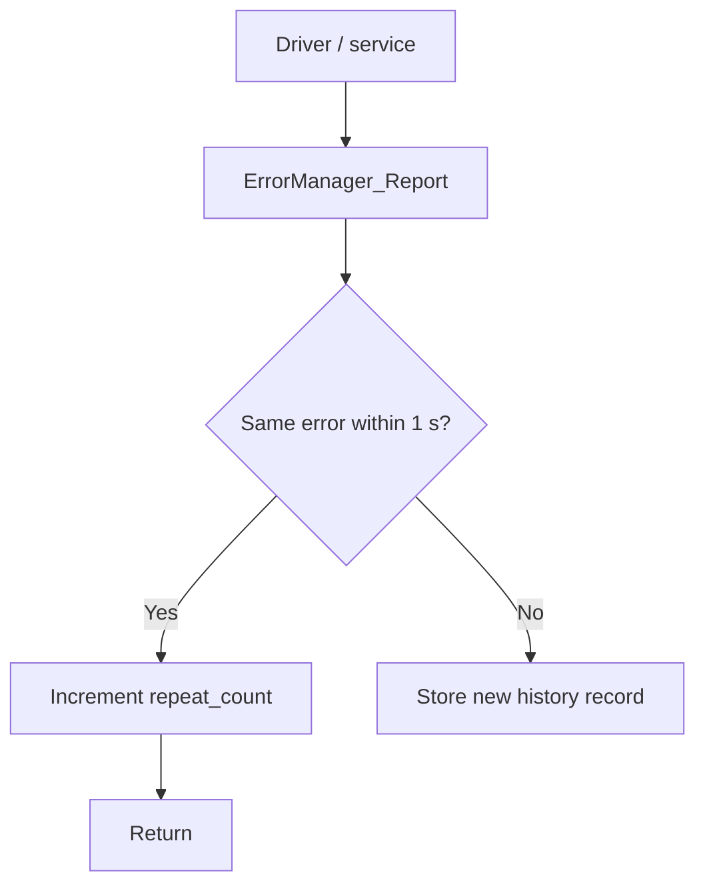

**Delivery after a new record is stored**

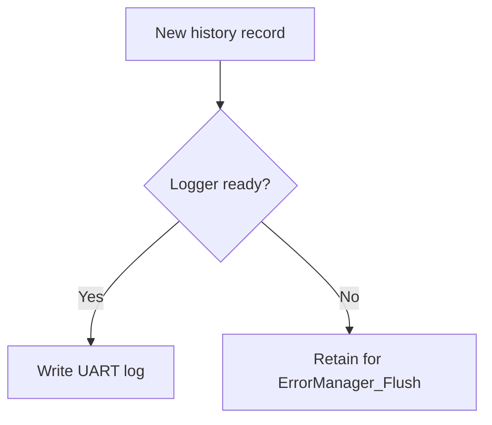

Monitored faults include:

- Flash metadata/integrity/range/programming failures.
- LCD I2C bus busy, start/address/data timeout, NACK, bus errors, or device not found.
- UART TX timeout.
- Button event FIFO overflow.
- ADC conversion timeout.
- PWM capture unavailable or invalid capture pair.

`NO_COMPONENT` and `NO_SIGNAL` are normal measurement states, not automatically treated as fatal errors.

### LCD bus fault handling

The LCD driver uses a **10 ms I2C operation timeout**. During startup it scans only likely PCF8574 address ranges instead of the whole 7-bit address space.

A NACK during address scan is expected. A NACK after the LCD has already reached the ready state is treated as a runtime fault and reported.

---


## Design Decisions and Trade-offs

This section captures choices that are especially relevant when reviewing the project as embedded firmware rather than only as a feature demo.

### Super-loop instead of RTOS

The application has a small number of concurrent concerns, so a super-loop keeps scheduling visible and deterministic:

```text
GPIO/event handling
+ measurement state progression
+ LCD state rendering
+ timeout checks
```

Interrupts handle only asynchronous timing/data capture. This avoids adding RTOS task stacks, synchronization primitives, and scheduler behavior that are not required by the current feature set.

### Minimal ISR policy

The ADC ISR performs integer accumulation only. PWM ISRs copy timer capture registers and timestamps. More expensive work is deferred to main context.

Benefits:

- Shorter interrupt occupancy.
- Less jitter for competing interrupts.
- No floating-point formatting in ISR context.
- Easier reasoning about shared state.

### Explicit measurement status

The UI does not infer state from a measurement value. `0 Ω`, `0 Hz`, no input signal, no component, and an actual hardware error are semantically different conditions.

The status enum makes those distinctions explicit and avoids using magic numeric results as control flow.

### Hardware ownership during mode transitions

`MeasurementService_SetMode()` owns peripheral lifecycle. UI states request a mode; they do not individually toggle every ADC/TIM resource.

This centralizes transitions such as:

```text
RESISTOR -> CAPACITOR
    cancel batch, preserve ADC enable

FREQUENCY_DUTY -> NONE
    disable PWM output and capture
```

### Filtering belongs near measurement policy

Generic ADC averaging/LPF stays in `adc_driver.c`, but resistance-specific median/EMA/deadband logic lives in `measurement_service.c`.

That separation is intentional: the ADC driver should not know that one particular analog channel represents a resistor requiring a visually sticky result.

### LCD shadowing and redraw throttling

LCD1602 over a PCF8574 backpack is much slower than internal MCU state changes. Rewriting a screen every main-loop iteration would waste I2C bandwidth and cause visible instability.

The project therefore combines:

- row shadowing;
- exact 16-cell row writes;
- change thresholds;
- mode-specific redraw periods.

### Expected-frequency based capture range

PWM capture range is selected from the expected frequency rather than detected automatically. This keeps timer ownership simple and gives each frequency range suitable counter resolution, but it means an unrelated external signal can be measured with the wrong timer if the expected/configured value does not match it.

### Flash integrity versus power-fail atomicity

The saved record has strong **detection** mechanisms:

```text
magic + version + size + range + CRC + read-back verify
```

However, the design uses a **single Flash page**. If power is lost after erase and before a complete verified write, the next boot will reject the record and fall back to defaults/legacy handling. It is not a redundant A/B journaled configuration store.

---
